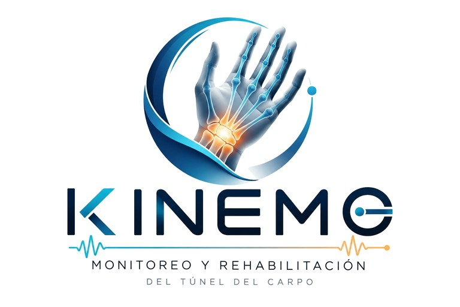

# Kinemo — Interfaz del profesional para el seguimiento de la rehabilitación (túnel del carpo)

<p align="center"></p>

Panel web local en el que el fisioterapeuta, terapeuta o médico revisa y analiza la evolución del paciente entre sesiones (brief DMR103-PBL-001, objetivo específico 4).

## Cómo abrirla

Desde esta carpeta:

```bash
python -m http.server 8765
```

Luego abra `http://localhost:8765` en **Google Chrome o Microsoft Edge**. Son los navegadores que permiten conectar el dispositivo USB. Necesita internet la primera vez para cargar Chart.js desde el CDN.

> Si inicia el servidor desde la carpeta superior, la dirección es `http://localhost:8765/interfaz-medico/`.

También está publicada en GitHub Pages: https://choclox.github.io/tunel-del-carpo/

### Inicio de sesión (demostración)

Al abrir el panel sin haber entrado se muestra `login.html`, con las pestañas **Iniciar sesión** y **Crear cuenta** (`login.html#registro` abre la segunda). Es una **maqueta**: no hay cuentas reales ni servidor, y cualquier correo y contraseña con formato válido dejan entrar. Al crear cuenta se pide nombre, profesión (Fisioterapeuta, Terapeuta ocupacional, Médico u Otro), correo y contraseña de al menos 8 caracteres. El panel muestra arriba a la derecha el nombre y la profesión del profesional y el botón **Cerrar sesión**. Al crear un paciente, "Profesional responsable" viene lleno con ese nombre.

En el navegador se guardan la sesión (`kinemo.sesion`) y las cuentas creadas (`kinemo.cuentas`: nombre, profesión y correo). **La contraseña nunca se guarda.** Los datos de pacientes no dependen de la cuenta: todos los profesionales que entren en el mismo navegador ven los mismos pacientes.

## Qué incluye

La pantalla tiene tres secciones. Lo técnico o secundario queda plegado ("Ver ficha", "Más indicadores", "Datos técnicos del dispositivo"…) para no saturar.

| Sección | Contenido |
|---|---|
| **Ejercicios** (hacer la rutina) | Tres pasos: **1 Conecte el dispositivo**, **2 Elija la fase** (Fase 1, 2 o 3, sugerida según los días desde la cirugía; "Ver los ejercicios de esta fase" muestra la lista, los cuidados y **Ver videos**) y **3 Empiece la rutina**. "Empezar rutina" abre "¿Listos para empezar?" (conexión y calibración automáticas) y luego graba ejercicio por ejercicio. Si no hay dispositivo conectado se usa el simulador y la sesión queda marcada como simulada. Al terminar, "Rutina terminada" pide dolor EVA, notas y conteos manuales, guarda la sesión y abre su detalle en Seguimiento. **Datos técnicos del dispositivo** (plegado) tiene el origen, la velocidad, la calibración manual, los indicadores de comunicación y la señal en tiempo real. |
| **Seguimiento** (cómo avanza) | **Resumen**: tres tarjetas (Avance, Dolor, Última sesión), la gráfica del ángulo máximo por sesión (en grados o % de lo normal), los 3 avisos automáticos más importantes ("Ver N más") y, plegado, **Más indicadores** (cumplimiento, dolor, velocidad, variabilidad o duración). **Una sesión**: tabla por ejercicio (con "Mostrar todas las columnas"), una insignia de calidad ("✓ Datos confiables" o los avisos que fallen), la tarjeta **Rutina: Fase N** si se grabó desde la rutina y, plegada, **Ver señal del sensor**. **Comparar**: dos sesiones lado a lado. Si el paciente no tiene sesiones, se ofrece "Ir a Ejercicios". |
| **Reporte** (historial y archivos) | Historial de sesiones (⚠ marca las que tienen pérdida de datos o calibración fallida), notas por sesión y **Archivos**: tabla para Excel (CSV), copia de seguridad de todos los pacientes y cargar archivo de sesión. "Restablecer datos de demostración" está en **Opciones de prueba**. |

Los datos se guardan en el navegador (`localStorage`). Use **Reporte › Copia de seguridad** para respaldarlos.

## Formato de archivo de sesión (lo que debe generar el dispositivo o el software de adquisición)

**Reporte › Cargar archivo de sesión** acepta un `.json` con esta estructura:

```json
{
  "pacienteId": "P-001",
  "sesion": {
    "fecha": "2026-10-01",
    "duracionMin": 22,
    "calibracion": { "tiempoS": 14.2, "ok": true },
    "perdidaDatosPct": 0.3,
    "dolorEVA": 3,
    "ejercicios": [
      {
        "tipo": "flexion",
        "repeticionesObjetivo": 10,
        "repeticiones": 10,
        "anguloMax": 62.4,
        "anguloMin": 1.2,
        "velocidadMedia": 41.0,
        "variabilidadPct": 3.1,
        "duracionS": 48,
        "senal": { "fs": 50, "angulos": [1.2, 1.5, 2.1] }
      }
    ]
  }
}
```

- Campos obligatorios por ejercicio: `tipo`, `repeticiones`, `repeticionesObjetivo`, `anguloMax`. Los demás son opcionales; si faltan, se muestran como "—" y no entran en los promedios.
- Valores de `tipo`: `flexion`, `extension`, `desv_radial`, `desv_cubital`, `puno`. Se configuran en `EJERCICIOS` dentro de [data.js](data.js).
- `senal` (opcional): la señal angular cruda en grados a `fs` Hz. Si no viene, la gráfica muestra una señal representativa reconstruida a partir de los indicadores, y lo indica en pantalla.
- `origen` (lo agrega el panel al guardar desde la rutina): `"usb"` o `"simulador"`. Las sesiones del simulador se marcan en el detalle.
- `rutina` (opcional, lo agrega el panel al guardar desde la rutina): `{ "etapa": 1, "pasos": [ ... ] }`. `etapa` es 1, 2 o 3 y `pasos` debe ser una lista (al importar se rechaza si no). Cada paso grabado tiene `id`, `nombre`, `tipo` (clave de `EJERCICIOS` o `null` si no se mide), `repeticionesObjetivo`, `repeticiones` (detectadas; `null` si no se midió), `repeticionesManual` (o `null`) y `duracionS`. Los pasos sin medición incluyen `senal: { fs, fe, rc, mcf }` con la señal cruda de los 3 canales reducida a ~10 Hz (`fs` indica la frecuencia efectiva). Los pasos medidos aparecen además en `ejercicios`. Las sesiones sin `rutina` se muestran igual que antes.
- `emg` (opcional, lo agrega el panel si el dispositivo envía EMG): `{ "prueba": { "tenar": { "picos": [410, 425, 401], "media": 412 }, "flexores": { "picos": [...], "media": ..., "extensoresDuranteFlexores": 96 }, "extensores": { ... } }, "senal": { "fs": 10, "tenar": [...], "flexores": [...], "extensores": [...] } }`. `prueba` es `null` si no se hizo la prueba de fuerza (Fase 1, omitida o incompleta). Al importar, cada músculo debe traer `picos` con 3 números; si falta `media`, se calcula.
- También se aceptan `"sesiones": [ ... ]` para importar varias sesiones a la vez, o un respaldo completo con `"pacientes": [ ... ]`.

## Ejercicios y monitoreo en vivo

Flujo: **Conectar (opcional) → Elegir fase → Empezar rutina → ¿Listos para empezar? (conexión y calibración) → ejercicio por ejercicio → Rutina terminada → Guardar sesión**.

La rutina es el único lugar donde se graba una sesión. Se pasa al ejercicio siguiente con un botón; con "Anterior" se puede volver a grabar un ejercicio, y el nuevo registro reemplaza al anterior. Si se cierra la ventana durante la grabación, se pregunta si terminar la rutina; lo ya grabado se puede guardar.

- **Origen** (en *Datos técnicos del dispositivo*). Elija *Dispositivo USB* para el prototipo real: el navegador pedirá elegir el puerto COM. Elija *Simulador* para probar sin hardware. Las sesiones del simulador quedan marcadas como tales.
- **Indicadores de comunicación.** Muestran la frecuencia de muestreo, la pérdida de datos (criterio < 1 %, calculada con el número de secuencia) y el tiempo desde el último dato (criterio ≤ 0,5 s). La pantalla se actualiza cada 100 ms.
- **Calibración.** Se mide desde que la PC envía `CAL` hasta que el dispositivo responde `CAL,OK`. Si pasa de 30 s, se marca como fallida. No se puede iniciar un ejercicio sin calibración válida.
- **Conteo automático.** Detecta cada repetición con umbrales con histéresis, relativos a la posición de reposo al iniciar el ejercicio. Los umbrales se adaptan a la amplitud de las repeticiones anteriores. La línea punteada de la gráfica muestra el umbral.
- **Conteo manual.** Escríbalo en la ventana "Rutina terminada" para calcular la exactitud del conteo automático (criterio ≥ 95 %). Sirve como evidencia para las pruebas FAT y SAT.
- **Ejercicios medidos y sin medir.** Los ejercicios de la rutina con `tipo` (flexión, extensión, desviaciones, puño) se miden y cuentan repeticiones con el detector. Los demás guardan la señal cruda de los 3 canales y su conteo es solo manual.
- **Al guardar,** la sesión incluye la señal cruda, los picos detectados y el registro de la rutina (campo `rutina`), y aparece en Evolución, Detalle, Comparar e Historial. Una sesión puede guardarse aunque ningún ejercicio grabado sea medido; en ese caso sus indicadores de movimiento se muestran como "—".

### Protocolo serie (115200 baudios, texto, una línea por mensaje)

| Sentido | Mensaje | Significado |
|---|---|---|
| Dispositivo → PC | `D,<seq>,<t_ms>,<fe>,<rc>,<mcf>` | Muestra (~50 Hz). `seq` es un contador creciente, `t_ms` el tiempo del dispositivo. Los ángulos van en grados: `fe` flexo-extensión (+flexión/−extensión), `rc` desviación (+radial/−cubital), `mcf` flexión de dedos. |
| Dispositivo → PC | `D,<seq>,<t_ms>,<fe>,<rc>,<mcf>,<emg1>,<emg2>,<emg3>` | Igual, con EMG: `emg1` tenar, `emg2` flexores, `emg3` extensores, enteros de 0 a 1000 ya sin el reposo. Otro número de campos o un EMG fuera de 0–1000 cuenta como línea no válida. |
| Dispositivo → PC | `CAL,OK,<ms>` / `CAL,ERR,<motivo>` | Resultado de la calibración. |
| Dispositivo → PC | `BAT,<pct>` | Batería (opcional). |
| Dispositivo → PC | `#texto` | Depuración (se ignora). |
| PC → Dispositivo | `START` / `STOP` | Iniciar o detener la transmisión. |
| PC → Dispositivo | `CAL` | Calibrar (posición neutra = 0°). |
| PC → Dispositivo | `EJ,<tipo>,<objetivo>` / `EJ,-` | Ejercicio en curso (informativo). |
| PC → Dispositivo | `PR,<musculo>` / `PR,-` | Contracción de la prueba de fuerza EMG en curso (informativo; el simulador la usa). |

[firmware/plantilla_protocolo/plantilla_protocolo.ino](firmware/plantilla_protocolo/plantilla_protocolo.ino) implementa este protocolo para Arduino y ESP32. Solo hay que reemplazar `leerAngulosCrudos()` por la lectura real de los sensores. Mientras tanto envía una señal de prueba. Cierre el monitor serie del IDE de Arduino antes de conectar desde la interfaz, porque el puerto solo admite un programa a la vez.

Si sus sensores miden otros ejes, ajuste `canal` y `signo` de cada ejercicio en `EJERCICIOS` ([data.js](data.js)).

### EMG: prueba de fuerza muscular

Tres canales EMG relacionan la rehabilitación con la mejora del músculo:

| Canal | Músculo | Colocación sugerida | Papel |
|---|---|---|---|
| EMG 1 | Eminencia tenar (abductor corto y oponente del pulgar) | Base del pulgar, en la palma; en la Fase 1 no se coloca por la herida | Músculo del nervio mediano: medida principal |
| EMG 2 | Flexores del antebrazo (flexor radial del carpo, flexores de los dedos) | Cara anterior del antebrazo, tercio proximal | Fuerza de agarre |
| EMG 3 | Extensores del antebrazo (extensor radial del carpo) | Cara posterior del antebrazo, tercio proximal | Control: no depende del mediano |

La colocación exacta la define el equipo con el profesional. Use siempre el mismo lugar en todas las sesiones.

- **Cuándo:** en las rutinas de **Fase 2 y 3**, si el dispositivo envía EMG, al pulsar "Terminar rutina" se abre **Prueba de fuerza muscular** antes de "Rutina terminada". "Omitir prueba" (o Esc) guarda la sesión sin prueba.
- **Cómo:** por músculo, 3 contracciones guiadas: "Prepárese 3, 2, 1" → "¡Fuerza!" 3 s → "Descanse" 5 s. Pulgar: separar el pulgar contra resistencia; flexores: apretar la pelota o el puño; extensores: llevar la muñeca hacia arriba contra resistencia. Si una contracción queda por debajo del 70 % del promedio, se ofrece "Repetir este músculo".
- **Medidas:** la primera prueba del paciente es la referencia (100 %). **Fuerza por músculo** = promedio de la sesión en % de la referencia. **Índice del nervio mediano** = (tenar ÷ extensores) en % de la referencia: sube si mejora el músculo del mediano más que el control. **Co-contracción** = extensores durante el bloque de flexores ÷ flexores: si baja, hay menos compensación.
- **Dónde se ve:** tarjeta **Músculo** y plegable **Fuerza muscular (EMG)** en Seguimiento › Resumen; tarjeta **Prueba de fuerza muscular** y **Ver señal EMG** en Una sesión; avisos si el índice baja más del 15 % frente a la prueba anterior o si la co-contracción supera el 30 %; columnas `emg_*`, `indice_mediano_pct` y `cocontraccion_pct` en el CSV.
- Los datos de demostración incluyen pruebas EMG desde la Fase 2. Si ya tenía datos guardados de antes, use **Reporte › Opciones de prueba › Restablecer datos de demostración** para verlos.

### Firmware real (ESP32 + GY-85)

[firmware/carpo_esp32/](firmware/carpo_esp32/) implementa el protocolo con un ESP32 y un solo GY-85 sujeto al dorso de la mano, con el antebrazo apoyado e inmóvil. `mcf` se envía siempre como 0, porque todavía no se mide.

- **Comandos de preparación (además de los del protocolo).** Se envían desde el monitor serie del IDE de Arduino (115200 baudios, con salto de línea) y hay que cerrarlo antes de conectar la interfaz, porque el puerto solo admite un programa a la vez. `MAG`: gire la mano en todas las direcciones durante unos 20 s para calibrar el magnetómetro; responde `#MAG,OK,...` o `#MAG,ERR,...` (`#MAG,ERR,sensor` si el GY-85 no responde) y el resultado queda guardado junto con el chip y el montaje. Repita `MAG` si cambia `MONTAJE_MAG` o la placa: mientras no haya un `MAG` válido para ese chip y montaje, el firmware usa fusión de 6 ejes (sin magnetómetro) y lo avisa al arrancar con `#Magnetometro sin calibrar: envie MAG`. `RAW`: activa o desactiva la salida `#RAW,...` a 5 Hz para comprobar los ejes. `MANO,D` / `MANO,I`: mano derecha o izquierda (queda guardado).
- **Comprobar los ejes con `RAW`.** Cada línea es `#RAW,ax,ay,az,gx,gy,gz,mx,my,mz,incl`: aceleración (g), giro (rad/s), campo magnético montado (µT) e `incl`, el ángulo entre la aceleración y el campo con el desfase de `MAG` restado (grados). Gire la mano alrededor de X (hacia los dedos) en sentido antihorario visto desde los dedos: `gx` debe ser positivo; si es negativo, corrija el signo en `MONTAJE_GIRO`. Después de `MAG`, `incl` debe mantenerse constante (± unos grados) en cualquier posición de la mano; si cambia al girarla, `MONTAJE_MAG` no coincide con `MONTAJE_ACEL`.
- **Desfase del acelerómetro.** El ADXL345 puede tener hasta ±0,15 g de desfase en Z (0,1 g da casi 5° de error a 60°). Con `RAW`, ponga cada eje hacia arriba y hacia abajo, quieto, y anote su valor máximo y mínimo: `desfase = (max + min) / 2` y `escala = 2 / (max − min)`. Escríbalos en `DESFASE_ACEL` y `ESCALA_ACEL` de `config.h` (por defecto `{0, 0, 0}` y `{1, 1, 1}`) y vuelva a cargar el firmware.
- **Mensajes al conectar.** Si la placa se reinicia al abrir el puerto, el texto de arranque de la ROM del ESP32 puede llegar como unas pocas líneas no válidas; es normal. Tras recuperar el sensor sin magnetómetro calibrado, o tras un `MAG`, el firmware envía `#Recalibre`: repita `CAL`.
- **Conexiones.** GY-85 VCC_IN a 3V3, GND a GND, SDA a GPIO21 y SCL a GPIO22, con una resistencia de 10 kΩ de SDA a 3V3 y otra de SCL a 3V3 (el GY-85 usado no trae pull-up en SDA). Todo se alimenta por el USB del PC: no hay batería y `MEDIR_BATERIA` está en `false`, así que el dispositivo no envía `BAT`. En la ESP32-C6 no use GPIO4, 5, 8, 9 ni 15 (pines de arranque).
- **Compilar.** Placa `esp32:esp32:esp32c6` (ESP32C6 Dev Module) con el core esp32 3.2.0, desde el IDE de Arduino o con `arduino-cli`. Conecte el cable al puerto USB marcado **UART**; si usa el puerto **USB** nativo, active *USB CDC On Boot: Enabled* en el menú Herramientas.
- **Opciones en `config.h`.** `TRANSMITIR_AL_ARRANCAR`: póngala en `true` si la placa se reinicia cuando el navegador abre el puerto y no llegan datos. `USAR_MAGNETOMETRO`: desactiva el magnetómetro en el filtro. `MONTAJE_*` define la orientación de los ejes de cada sensor.
- **EMG.** En `config.h`: `USAR_EMG` (por defecto `false`: no cambia nada), `EMG_MODO` (`Envolvente`, p. ej. MyoWare 2.0 salida ENV; o `Crudo`: muestrea a 1000 Hz, resta `EMG_CENTRO_MV` y envía el RMS de 50 ms), `PINES_EMG = {0, 1, 3}` (tenar, flexores, extensores) y `EMG_MAX_MV` (lectura que equivale a 1000). Durante `CAL` se mide el reposo de cada canal y se resta después. El comando `PR` se acepta y no hace nada.
- **Pruebas en el PC.** Una sola vez `python -m pip install ziglang==0.13.0`; luego `python firmware/pruebas/correr.py`.
- **Pendiente.** La validación en banco todavía no se ha hecho. Son dos criterios separados: exactitud, con error ≤ 3° frente a un goniómetro; y estabilidad, 60 min seguidos sin reinicios con pérdida de datos < 1 %.

## Archivos

- `index.html`: estructura de la interfaz.
- `styles.css`: estilos, con modo claro y oscuro.
- `data.js`: catálogo de ejercicios, datos de demostración y señal.
- `app.js`: lógica, gráficas, importación y exportación.
- `monitoreo.js`: monitoreo en vivo (puerto serie, simulador, conteo de repeticiones).
- `rutinas.js`: contenido de las rutinas por etapa (ejercicios, repeticiones, cuidados) y funciones puras con pruebas.
- `rutina.js`: ventanas de la rutina (revisión y grabación), "¿Listos para empezar?" y "Rutina terminada".
- `login.html`, `login.js`: página de inicio de sesión y registro (maqueta).
- `acceso.js`: validación de los formularios y sesión de demostración; funciones puras con pruebas.
- `emg.js`: formato de la línea D con EMG, picos, línea base y medidas; funciones puras con pruebas.
- `prueba-emg.js`: ventana guiada "Prueba de fuerza muscular".
- `navegacion.js`: secciones (Ejercicios, Seguimiento, Reporte), vistas de Seguimiento y recorte de avisos; funciones puras con pruebas.
- `tests/ui/humo.mjs`: prueba de humo de la interfaz en Chromium.
- `videos/`: un `.mp4` por ejercicio de la rutina (ver [videos/LEEME.md](videos/LEEME.md)).
- `firmware/plantilla_protocolo/`: plantilla de firmware con el protocolo.
- `firmware/carpo_esp32/`: firmware real para ESP32 + GY-85 (`carpo_esp32.ino`, `config.h`, `gy85.*` y `src/nucleo/`).
- `firmware/pruebas/`: pruebas del núcleo del firmware en el PC (`correr.py`, `test_*.cpp`).

Pruebas (necesita Node): desde esta carpeta, `node --test`.

Prueba de humo de la interfaz en el navegador (necesita Playwright con Chromium): `node tests/ui/humo.mjs`. Recorre las tres secciones y graba una rutina completa con el simulador. Sin acceso al CDN de Chart.js, copie el paquete `chart.js@4.4.1` en `node_modules/chart.js` (por ejemplo `npm pack chart.js@4.4.1` y descomprímalo ahí) y la prueba usa esa copia.

> Prototipo académico. No es un dispositivo médico certificado. Complementa, pero no sustituye, el criterio clínico del profesional.
